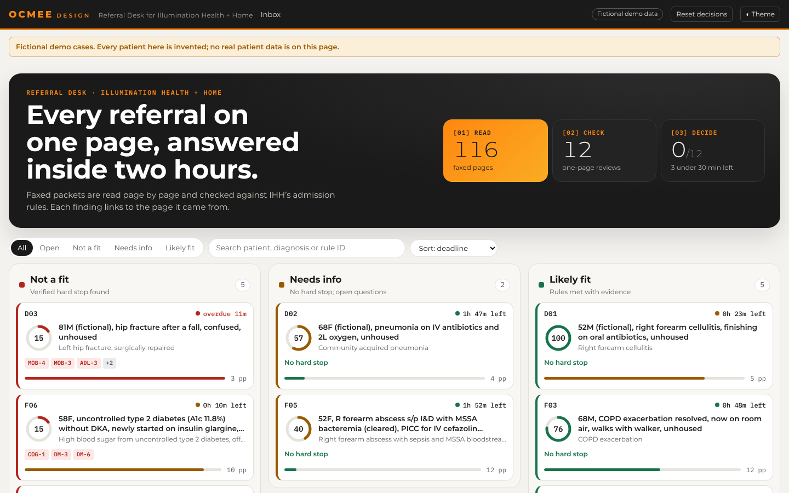
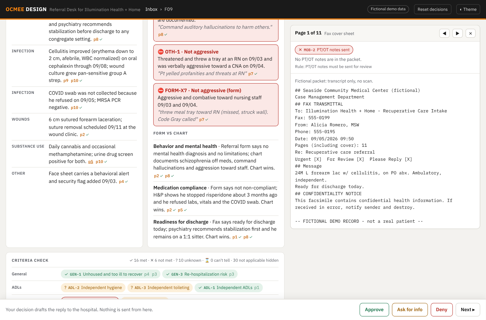

# Referral Desk

> For Illumination Health + Home's referral coordinator: reads a 15 to 35 page faxed referral, checks it
> against IHH's own admission rules with a page citation for every finding, and turns it into one page
> with a fit score, the blockers, and a drafted reply to the hospital.

**Team:** OCMEE Design
**Members:** Cornel, Oana
**Challenge:** 1 Referral intake
**Built at:** Orange County | Claude Impact Lab, October 17, 2026, with Illumination Health + Home

**Try it:** https://ocmee.github.io/ihh-referral-intake/ (12 fictional referrals, nothing to install).
Offline copy: [app/index.html](app/index.html), download and open in a browser.
**Demo video:** [link to be added]

## The problem

A hospital wants to discharge a patient who is homeless but still too sick to recover outside, and faxes
IHH a referral: 15 to 35 scanned pages, read by hand against IHH's admission criteria. IHH promises an
answer within two hours, and hospitals send the same referral to several providers, so a slow answer can
mean the patient leaves with nowhere to go. The referral form is one person's summary; the fact that
decides the case is often deep in the chart, and missing information is easy to read as normal.

## What we built

Referral Desk has three screens.

1. **Inbox.** Every referral with its fit score, the blocking rules by ID, and a 2-hour reply clock,
   most urgent first. Filter, search and sort.
2. **Review.** One page per referral: key facts, a fit score ring, the blockers with the exact quote,
   where the referral form contradicts the chart, every IHH rule as met / not met / unknown /
   can't tell, missing documents, and the questions to ask the hospital.
   **Evidence panel:** click any page number or rule and that page opens beside the summary, with the
   quote highlighted (the original scan in the real build, the transcript in the public build).
   **Proof behind the score:** next to the ring, one click opens the original PDF, the readable PDF,
   a printable fit checklist (every IHH rule with status, finding and cited page, plus the
   DOC-1 to DOC-10 document checklist), IHH's own admission criteria, and a Word copy.
3. **Decide.** Approve, Ask for info or Deny drafts the reply to the hospital with page references.
   The coordinator edits it and copies it into their own fax or email. Nothing is ever sent.

It also produces, per packet: a readable PDF (each scan beside its typed transcript), a compact Word
version that keeps the look of each form, and a searchable explorer across all packets.




## How Claude is used

**Building it.** Claude Code wrote the pipeline, the app and the tests with us, ran the criteria checks
in parallel sub-agents, and wrote the fictional demo cases.

**Inside the tool, per packet:**

| Step | Claude does | A person or a script checks |
|---|---|---|
| Read | Transcribes every page image, keeps page numbers, marks redactions `[REDACTED]`, unclear checkboxes `[?]`, unreadable text `[illegible]` | Readable PDF puts each scan beside its transcript |
| Check | For each IHH rule: status, one-line finding, exact quote and page. Never sees IHH's decisions | `score.py` confirms every quote is on the page it cites; anything not found shows "check" |
| Score | Gives its own read (score + recommendation) as a second opinion | `score.py` computes the rule-based fit score from the statuses, so every point is explainable |
| Decide | Drafts the reply | The coordinator decides, edits and sends it themselves |

## Try it

**Public demo (fictional data, nothing to install):** open `app/index.html` in a browser.

**GitHub Pages:** Settings → Pages → Source: **GitHub Actions**, then Actions → "Publish Referral Desk"
→ Run workflow. The workflow publishes `app/` only and refuses to run if it finds a real packet ID.

**Drop in a new referral (local only):** runs the whole pipeline on one PDF from the browser.

```bash
pip install pymupdf anthropic reportlab pydantic
export ANTHROPIC_API_KEY=...           # Windows PowerShell: $env:ANTHROPIC_API_KEY="..."
export ANTHROPIC_WORKSPACE_ID=wrkspc_...   # only if the key is not scoped to a workspace
python src/desk_server.py              # open http://127.0.0.1:8000, drop a PDF on the inbox
python src/desk_server.py --dry-run    # no API: accepts the fictional app/pdf/F01-F09.pdf only
```

The PDF is saved to `output/U01/` (git ignored), straightened (`ocrmypdf` if installed), transcribed by
Claude page by page, checked against IHH's rules by Claude (`src/check.py`), then `score.py` verifies
every quote. Quotes not found on their page go back to Claude once to correct; any still missing show as
"check". The new referral opens on its own with its reply clock started at upload. The server listens on
127.0.0.1 only. Untested with the live API at the event (no key in our build environment); the dry run
tests every other step.

**Full pipeline on the real packets (local only):**

```bash
pip install pymupdf anthropic reportlab pydantic python-docx
npm install docx                       # for the Word export
export ANTHROPIC_API_KEY=...           # Windows PowerShell: $env:ANTHROPIC_API_KEY="..."
export IHH_OUTPUT=/path/outside/any/synced/folder   # optional, default output/ (git ignored)

python src/clean.py challenges/1-referral-intake/packets/R01.pdf --transcribe --skip-fix
#   -> output/R01/R01.pages.json + R01.readable.pdf   (repeat for each packet)
#   criteria check: output/RXX/RXX.json in the shape of CONTRACT.md
python src/score.py                    # verify quotes, compute fit scores
python src/onepager.py                 # one-page summaries + index
python src/build_app.py --real         # output/app/index.html with the original scans
python src/evaluate.py                 # compare with IHH's decisions (only after checking)
node src/to_docx.js output/R??/R??.pages.json && python src/verify_docx.py output/R??/R??.pages.json
```

Packets go in `challenges/1-referral-intake/packets/` (download link in that folder's README). Git
ignores them and everything in `output/`.

## What is real and what is mocked

| Part | Status |
|---|---|
| Transcription of the 11 IHH packets (282 pages) | Working. Done in-session with Claude page by page; `clean.py --transcribe` does the same through the API (not yet run end to end with a key) |
| Criteria check against IHH's rules, with quotes and pages | Working on all 11 real and 12 fictional packets |
| Quote verification, fit score, one-pagers, app, Word export | Working |
| Evidence panel with original scans | Working in the local real build; public build shows transcripts |
| 2-hour clock | Mocked: arrival times are simulated |
| Saving decisions | Working, in the browser only (localStorage); no database, no login |
| Sending the reply | Not built on purpose: the tool never sends email or fax |
| Uploading a new PDF from the app | Not built; runs from the command line |

## Results on IHH's 11 real packets

Run blind: the checks never saw `eval/decisions.json`.

| IHH decided | Tool said |
|---|---|
| Deny, 4 packets | Likely not a fit, 4 of 4, each with a verified blocker and page |
| Approve, 7 packets | Needs info, 5 of 7, with questions for the hospital |
| Approve, 7 packets | Likely not a fit, 2 of 7 (see below) |

- 459 of 459 criteria quotes were found on the page they cite.
- 386 of 386 Word pages match their transcripts (real and fictional), checked by `verify_docx.py`.
- On the 9 fictional "Doe" packets, the rule score matched the outcome each case was written for on 7 of 9.

## Where it gets things wrong

- **Two IHH approvals scored "not a fit".** In one, the echo ejection fraction is below the 25% in
  rule CARD-5; in the other, orientation fluctuates between notes (COG-2). IHH said yes anyway, so
  either they weigh these differently in practice or the packet shows something we missed. We would
  ask IHH before trusting either rule.
- **The score is tuned in-sample.** The first weights rated all 11 packets "not a fit", because IHH
  approves packets with many unknowns. We lowered the unknown penalties after seeing the decisions,
  so agreement on these 11 is not a validation.
- **Transcripts are AI-made.** Quotes are checked against the transcript, and the transcripts were
  spot-checked against the scans, not proofread line by line. Faint labs, sideways medication
  records and handwriting are the weak spots; those pages are flagged "check by hand".
- **Timing rules.** With dates redacted, rules like "24 hours on insulin" are "can't tell". On the
  fictional packets, where dates exist, the tool says "not a fit" when the honest answer is "not yet":
  the rules have no "re-refer when ready" outcome.
- **Never trust it to approve on its own.** No packet scores "likely fit" without a coordinator's review.

## Next steps

- Pilot beside a coordinator on live faxes, with the API transcription running end to end.
- Let coordinators mark a finding right or wrong, and tune the weights on 50+ labelled past referrals.
- Add a "not yet, re-refer at …" answer for timing rules.
- A second, independent read of every blocker before it is shown.

## Data and privacy

This project uses only data from the event repo and public sources. It contains no real patient or
client information: the 11 de-identified IHH packets and everything derived from them (transcripts,
scores, summaries, Word files, the real app build) stay in git-ignored folders on the team's laptop,
and git history was checked for them. The demo cases in `demo/` are invented ("Doe" patients,
"(fictional)" facilities, 555-01xx numbers). The tool does not connect to any Illumination Health +
Home system and sends nothing.

The event's own README is in [docs/event-readme.md](docs/event-readme.md).

## License

[MIT](LICENSE)
